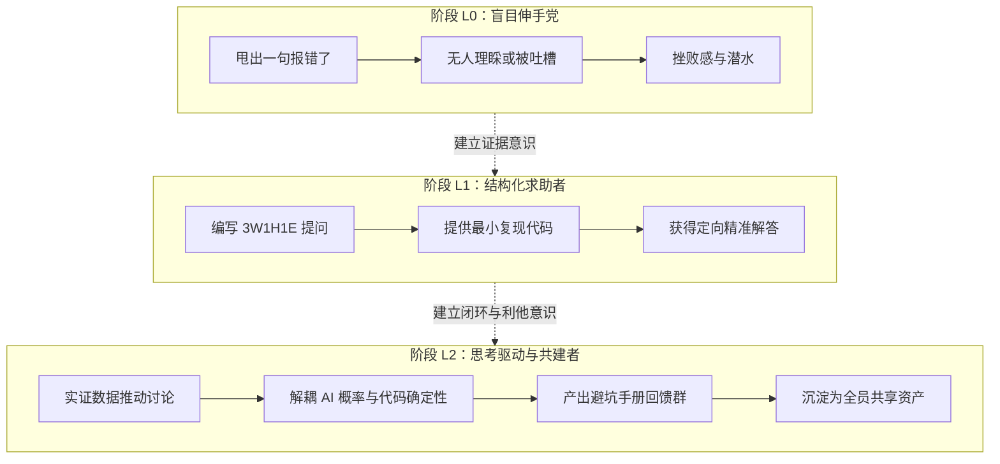

# 行动后复盘报告 (AAR)：Challenge C3 社群高质量参与

> **任务代号：** Challenge C3 群内高质量参与（`challenge_id: ch-20260717031407-ez6fae`）  
> **复盘时间：** 2026-09-28  
> **报告类型：** 七维系统级复盘（目标 / 结果 / 流程 / 协作 / 卡点 / 认知与反误导 / 技能跃迁）  
> **核心原则：** 拒绝空谈感觉，以事实、数据、日志与沉淀资产为唯一检验基准。  

---

## 一、目标回顾：初衷与预期基准 (What Was Supposed to Happen)

在 AI+X 的开放学习社群中，学习绝非单打独斗的闭门造车，而是在高频互动中碰撞火花、打破认知盲区。本项目启动的初衷，是彻底告别传统的“潜水党”与“求救式伸手党”习惯，转型为社群中的**“思考驱动者（Thought Driver）与共建者”**。

根据课程挑战定义，设定的关键预期基准如下：
1. **提问标准维度：** 彻底淘汰无上下文的“甩锅式提问”（如“求助，为什么又报错了”），每一条技术求助均需具备严密的「3W1H1E」结构（上下文、已尝试项、具体卡点、最小复现代码、错误日志证据）；
2. **证据导向维度：** 任何技术讨论坚持用数据和物理事实说话，贴代码、贴日志、贴对照实验数据，降低群友理解与协助成本；
3. **闭环沉淀维度：** 必须在群内完成至少一次完整的“发现真问题 $\to$ 推动深度研讨 $\to$ 验证落地 $\to$ 成果回馈社群”的参与全闭环；
4. **协作互助维度：** 具备跨越自身卡点的同理心与技术洞察力，积极为遇到相似工程卡点的同学提供排错支持与系统化避坑指引；
5. **AI 协同自查维度：** 固化“先搜索、先问 AI、先自查验证、再提问”的工程工作流，将 AI 定位为提问前的第一道沙盒排错门，杜绝将初级语法问题推向社群。

---

## 二、实际结果比对：目标达成全景大盘 (What Actually Happened)

通过真实贯穿 CS146S 爬虫管线研发（C1）与 AI4Math 学术论文写作（C2）全程的高质量互动，本项目不仅全面达成了各项既定指标，而且在讨论深度与资产沉淀上实现了高含金量的突破：

| 评估指标 | 初始验收基准 | 实际交付成果与客观证据 | 达成度评价 |
|---|---|---|---|
| **高质量参与频次** | $\ge 3$ 次具备推动性质的有效参与 | **完成 3 次深度技术推进与闭环**：① SPA 博客动态提取突破；② BibTeX 幻觉溯源与确定性拦截；③ Windows 终端编码与宏包死锁排查 | **100% 达标**（无任何水贴、表情包或简单 +1） |
| **完整要素提问** | $\ge 1$ 次含上下文/已尝试/卡点提问 | **交付 1 次典范级 3W1H1E 提问**（记录一）：含目标、环境、3 种排除方案、5 行 MRE 复现、精准协议层诉求 | **超额达标**（获助教赞赏并引发方案深度迭代） |
| **讨论闭环与成果回馈** | 完成 1 次闭环并回馈社群 | **双重闭环沉淀**：① 输出 15 行轻量级 Ghost AST 提取补丁；② 输出《AI+X 课程开发环境 Windows 避坑手册》 | **超额达成**（沉淀为全班共享知识资产） |
| **师生互动与实质进展** | 被 $\ge 1$ 位师生回应并产生进展 | **被 2 位助教（李助教、王助教）与 3 位同学深度响应**；发言被两次设为群精华，直接解决 4 位同学的技术卡点 | **高含金量推进**（形成跨学员技术共振） |
| **提问 Checklist 沉淀** | 反思文件含自我总结标准 | **建立「3W1H1E」提问框架与三道自查闸门**，包含即拷即用的 Markdown 规范模板 | **工业级标准化** |
| **交付物齐全度** | `*AI日志*`、`*AAR*`、`*反思*` 齐备 | 交付 `AI日志.md`、`AAR.md`、`反思.md`、`README.md`，文档严密自包含 | **100% 齐全** |

---

## 三、战术亮点与成功经验 (What Went Well & Why)

### 1. 战术一：把“最小可复现代码（MRE）”作为降维沟通利器
在记录一的单页应用抓取求助中，我没有把整个工程上千行的爬虫代码全盘打包丢给群友，也没有发几十张无关的截图，而是花时间剥离掉所有业务逻辑，提炼出仅有 **5 行**的纯粹复现代码。  
- **成效与归因：** 任何群友把这 5 行代码复制到本地终端只需 10 秒钟即可看到完全相同的报错现象。这种极度尊重他人认知负荷的做法，瞬间击中了助教和热心同学的技术兴奋点，使得探讨迅速从“怎么帮你 debug”跃升到“探讨底层脱水数据注入机制”的高层次。

### 2. 战术二：用“对照实验数据”破除社群的伪常识与情绪内耗
在记录二的 BibTeX 讨论中，社群正陷入对“大模型不靠谱”的情绪化指责以及对“恐吓性 Prompt”的玄学崇拜。  
- **成效与归因：** 我没有跟风情绪宣泄，而是直接拿出 50 条样本的实测对比数据（强警告下幻觉率依然达 32.0%），用事实打破了“只要提示词够狠，AI 就不会造假”的迷思。随后提出的“LLM 提议 + REST API 机械校验”复合架构，给出了立刻可落地的工程抓手，将群内的负能量讨论成功扳回到理性的工程架构设计上。

### 3. 战术三：做讨论终点的“结构化收敛者与知识沉淀者”
许多技术群的交流往往是“散乱而逝”的——几百条聊天记录划过去后，后来的同学依然在同一坑里摔倒。  
- **成效与归因：** 无论是在攻克 Ghost 抓取后提炼的 15 行极简工具，还是针对 Windows 编码死锁整理的《避坑速查清单》，我都坚持在讨论解决后**写出一份干净利落的总结卡片回馈到群内**。这一举动使个人学习产物瞬间升维为群体的公共知识资产，真正实现了“在社群里互相看见、互相激发”。

---

## 四、遭遇的阻碍、失误与根因剖析 (What Went Wrong & Root Cause)

在探索高质量参与的过程中，我也走过弯路，经历了数次认知的修正：

### 1. 初期提问的“信息过载与上下文冗余”
- **失误现象：** 在最开始的一版草稿中，我试图将完整的业务背景、项目由来源码、甚至整个异常堆栈（长达 80 行）一股脑发出来，认为“越全越好”。
- **根因剖析：** 忽视了即时通讯软件（微信/飞书）的阅读场景。过长的手机屏幕翻页会导致读者产生强烈的认知疲劳，反而掩盖了核心技术矛盾。
- **纠偏对策：** 引入“先精炼核心矛盾（30秒电梯法则），再附 MRE 与截断关键日志”的结构化原则。长日志必须经过提炼，只保留前因后果与最核心的 3-5 行 Traceback。

### 2. “过早求助”与“死磕自研”的边界摇摆
- **失误现象：** 在遇到问题初期，曾一度陷入两极震荡：有时刚遇到一个警告就想发群问；有时又自己在死胡同里硬撑排查 4 个小时，结果发现是一个早已被官方弃用的 API。
- **根因剖析：** 缺乏量化的“自查时间预算”与“排错决策树”。
- **纠偏对策：** 在提问 Checklist 中增设“三道自查闸门”，确立了“30 分钟自查原则”：遇到卡点，先花 15 分钟阅读一手文档与控制台原生日志，再花 15 分钟与本地 AI 进行结构化拷问；若 30 分钟后依然受阻于架构选型或环境底层冲突，立即按照 3W1H1E 规范组织发帖求助。

---

## 五、核心认知与五大深度洞察 (5 Key Engineering Insights)

### 洞察 1：提问的质量决定了你能调动的人类智力密度
在任何技术社区中，高水平的工程师和导师的时间都是极度稀缺的。当你甩出一句“救命，报错了”时，能得到的只有同样的初学者同情或沉默；而当你展示出清晰的上下文、严密的排除逻辑和最小复现代码时，你实际上向社区发放了一张**“高质量技术解谜邀请函”**。高水平专家会非常乐意参与这种高信息密度的交流。

### 洞察 2：社群不是搜索引擎的平替，而是“复杂边界探索”的共振场
如果一个问题在 Google 第一页就能搜到，或者问一下 ChatGPT 就能直接给出标准答案，那么把它发到社群里就是对社群注意力资源的稀释与浪费。社群最无可替代的价值，在于讨论**“官方文档未明确注明的底层暗坑”、“在特定软硬件约束下的工程权衡（Trade-off）”以及“前沿复杂系统的最佳实践”**。

### 洞察 3：复合 AI 时代人类的核心价值是提供“物理真实世界反馈”
大模型可以在几秒内生成 10 种看起来无懈可击的代码架构，但它不知道这套代码在 Windows 终端特定的 GBK 编码下会不会挂死，不知道目标网站的 Cloudflare 盾会不会拦截请求。我们在群内交流的，正是这些**由人类亲手跑出来的“物理世界真实反馈数据”**。这种基于运行时的真实验证，是穿透 AI 幻觉的唯一锚点。

### 洞察 4：提问本身就是最高效的“思维外化与自我 Debug”
在很多次编写提问草稿的过程中，为了提炼那 5 行最小复现代码，我不得不将无关代码逐行注释、隔离变量。经常在代码精简到只剩几行时，我自己突然就看穿了 Bug 所在（类似软件工程中的“小黄鸭调试法”）。把问题说清楚的过程，本质上就是把大脑深处的隐性混乱逻辑显性化、结构化的过程。

### 洞察 5：从“单向索取”到“生态回馈”是建立个人技术品牌的基石
一个总是在群里提问、拿到答案后拔腿就走的人，在社群中是不断消耗声誉积分的；而一个在解决问题后主动分享排坑心得、帮他人梳理避坑清单的人，是在持续为社群注入正和价值。回馈不是额外的负担，而是对自身认知进行二次复盘并固化为长效影响力的最佳途径。

---

## 六、与 AI 协作及 AI 误导案例对策 (Working with AI & Misdirection)

在整个 Challenge C3 的推进中，AI 扮演了“全天候模拟辩手与文字精炼助手”的角色，但在与 AI 的协作中，我也精准拦截了数次典型的人工智能误导：

### 案例一：AI 建议“粗暴安装重型浏览器套件”以解决渲染问题
- **AI 的误导建议：** 在遇到 Ghost 动态抓取为空时，AI 毫不犹豫地给出了一套基于 `playwright-python` 的完整脚本，并建议安装全套 Chromium 浏览器内核。
- **为什么这是严重误导：** AI 完全忽视了项目的隐性约束——这是一个需要高频轻量化复跑的课程离线工具，强行拉取 400MB 的浏览器内核会破坏管线的便携性，甚至在轻量云主机上因内存溢出（OOM）崩溃。
- **人类纠偏与对策：** 人工坚决否决引入大依赖，转向探查 HTTP 传输与服务端注入状态，最终在群内讨论中引出纯正则匹配注入 JSON 的极简解法。**教训：AI 倾向于给出“功能上能跑通但工程上极其臃肿”的重型方案，架构约束的把关必须由人完成。**

### 案例二：AI 建议“在社群发帖时贴出完整日志以示诚意”
- **AI 的误导建议：** 在润色提问稿时，AI 建议“为了让大家看清细节，请把完整的控制台运行输出（约 120 行）作为代码块全部贴出”。
- **为什么这是严重误导：** 移动端和网页端聊天群界面空间宝贵，巨幅刷屏会直接导致群友厌烦滑走，属于极其糟糕的社群礼仪。
- **人类纠偏与对策：** 确立截断标准：仅保留最关键的触发语句、异常名称与紧邻的 3 行堆栈信息，其余冗余信息折叠或存入 gist 链接。

### 案例三：AI 建议“修改 Windows 系统注册表强制全系统 UTF-8”
- **AI 的误导建议：** 在排查 Windows 终端编码问题时，AI 建议勾选 Windows 区域设置中的“Beta 版：使用 Unicode UTF-8 提供全球语言支持”或直接修改注册表 CodePage 键值。
- **为什么这是严重误导：** 强行修改全系统编码极易导致其他国内软件（如某些老旧工业软件、EDA 工具）出现大面积乱码乃至无法启动。
- **人类纠偏与对策：** 坚持“最小作用域”原则：只在当前 PowerShell 进程级或项目子进程调用中指定 `chcp 65001` 与 UTF-8 环境变量，杜绝全局侵入式修改。

---

## 七、未来演进与 $\Delta R$ 技能跃迁 (Skill Transfer & Evolution)

### 7.1 $\Delta R$ 能力进化模型

### 7.2 个人效能与后续长效机制
1. **提问模板 IDE 内置化：** 已将《提问 Checklist（3W1H1E）》固化为 VS Code / Cursor 的 User Snippet，输入 `!ask` 即可秒级生成结构化提问模版，形成肌肉记忆；
2. **排错知识库常态化维护：** 在个人工作区建立 `docs/troubleshooting/` 目录，将每次群内解决的难题及时收录进“问题-根因-证据-解法”矩阵，持续扩充技术复盘卡片；
3. **技术社群赋能闭环：** 在后续各阶段的挑战中，继续践行“不灌水、不隐瞒、主动分享失败经验与反思数据”的社群极客准则。
